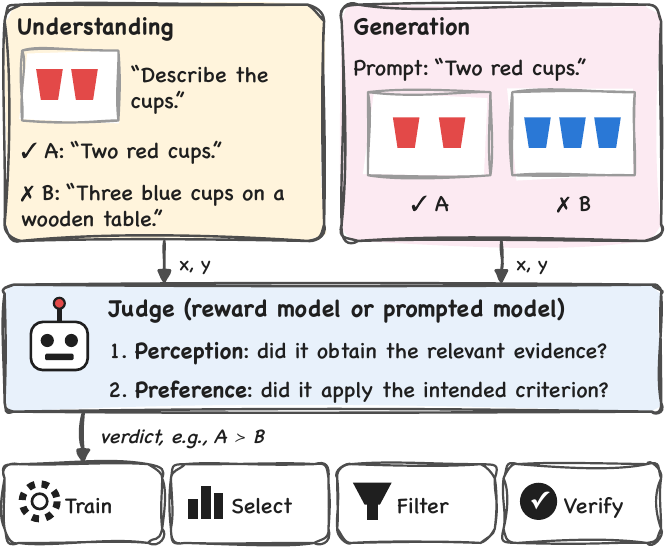
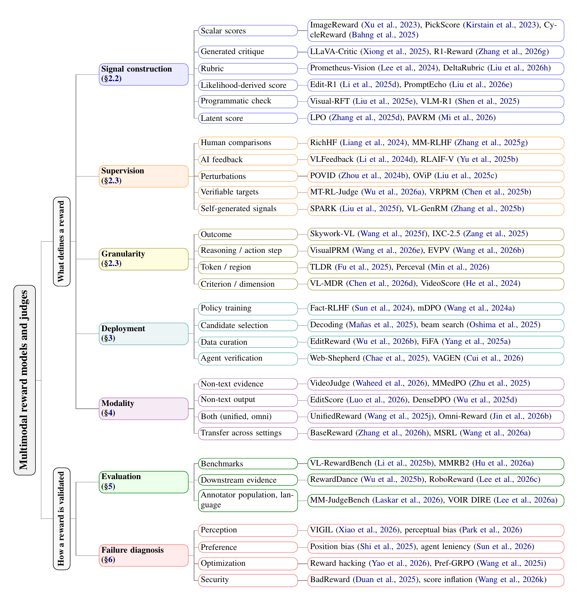

# Awesome multimodal reward models and judges

A curated list of 256 papers on reward models and judges that check answers against images, video, or audio, or that score generated images, video, audio, and 3D assets. It accompanies the survey *From Perception to Preference: A Critical Survey of Multimodal Reward Models and Judges*.

- **Explore the papers:** search, filter by how a reward is built and used, and export BibTeX in the [paper explorer](https://dipta007-mmreward.static.hf.space/). To run it locally, open `site/index.html` in a browser.
- **Suggest a paper:** [open a suggestion](https://github.com/dipta007/awesome-multimodal-reward/issues/new?template=add-paper.yml), or edit `papers.yaml` in a pull request.

<p align="center"></p>

The survey asks three questions. What transfers between reward tasks? Which evaluations predict downstream use? How can a wrong verdict be diagnosed? Its taxonomy describes a reward by what defines it (signal construction, supervision, granularity, deployment role, modality) and by how it is validated (evaluation, failure diagnosis).

<details>
<summary>Taxonomy (Figure 2 of the survey)</summary>
<p align="center"></p>
</details>

<!-- papers:start -->
## Contents

- [Foundations](#foundations) (10)
- [Signal construction](#signal-construction) (37)
- [Supervision](#supervision) (23)
- [Granularity](#granularity) (11)
- [Deployment roles](#deployment-roles) (28)
- [Understanding tasks](#understanding-tasks) (19)
- [Generation tasks](#generation-tasks) (30)
- [Transfer and unified rewards](#transfer-and-unified-rewards) (9)
- [Benchmarks and evaluation](#benchmarks-and-evaluation) (34)
- [Failure diagnosis](#failure-diagnosis) (33)
- [Related surveys](#related-surveys) (22)

## Foundations

How reward models and preference optimization work, in text and for non-text outputs. Survey: Section 2, Appendix B.

### From human feedback to reward models

- [RewardBench: Evaluating Reward Models for Language Modeling](https://aclanthology.org/2025.findings-naacl.96/) (Findings 2025) [[arXiv](https://arxiv.org/abs/2403.13787)]
- [Prometheus: Inducing Fine-Grained Evaluation Capability in Language Models](https://proceedings.iclr.cc/paper_files/paper/2024/hash/803485352e61e3ebf41221e4776c9fd4-Abstract-Conference.html) (ICLR 2024) [[arXiv](https://arxiv.org/abs/2310.08491)]
- [Direct Preference Optimization: Your Language Model is Secretly a Reward Model](https://proceedings.neurips.cc/paper_files/paper/2023/hash/a85b405ed65c6477a4fe8302b5e06ce7-Abstract-Conference.html) (NeurIPS 2023) [[arXiv](https://arxiv.org/abs/2305.18290)]
- [Training language models to follow instructions with human feedback](https://proceedings.neurips.cc/paper_files/paper/2022/hash/b1efde53be364a73914f58805a001731-Abstract-Conference.html) (NeurIPS 2022) [[arXiv](https://arxiv.org/abs/2203.02155)]
- [Deep Reinforcement Learning from Human Preferences](https://proceedings.neurips.cc/paper_files/paper/2017/hash/d5e2c0adad503c91f91df240d0cd4e49-Abstract.html) (NeurIPS 2017) [[arXiv](https://arxiv.org/abs/1706.03741)]

### Scoring non-text outputs

- [Qwen-Image technical report](https://arxiv.org/abs/2508.02324) (arXiv 2025)
- [VBench-2.0: Advancing Video Generation Benchmark Suite for Intrinsic Faithfulness](https://arxiv.org/abs/2503.21755) (arXiv 2025)
- [VBench: Comprehensive Benchmark Suite for Video Generative Models](https://openaccess.thecvf.com/content/CVPR2024/html/Huang_VBench_Comprehensive_Benchmark_Suite_for_Video_Generative_Models_CVPR_2024_paper.html) (CVPR 2024) [[arXiv](https://arxiv.org/abs/2311.17982)]
- [GenEval: An object-focused framework for evaluating text-to-image alignment](https://proceedings.neurips.cc/paper_files/paper/2023/hash/a3bf71c7c63f0c3bcb7ff67c67b1e7b1-Abstract-Datasets_and_Benchmarks.html) (NeurIPS 2023) [[arXiv](https://arxiv.org/abs/2310.11513)]
- [CLIPScore: A Reference-free Evaluation Metric for Image Captioning](https://aclanthology.org/2021.emnlp-main.595/) (EMNLP 2021) [[arXiv](https://arxiv.org/abs/2104.08718)]

## Signal construction

What a reward model or judge returns, and how the score is computed. Survey: Section 2.2, Appendix C.

### Scalar scores

- [TuneJury: An Open Metric for Improving Music Generation Preference Alignment](https://arxiv.org/abs/2606.17006) (arXiv 2026) `music` `audio` `selection` `training` `data curation`
- [Vision-SR1: Self-Rewarding Vision-Language Model via Reasoning Decomposition and Multi-Reward Policy Optimization](https://proceedings.iclr.cc/paper_files/paper/2026/hash/8442d394d8266db6fdf92583a4783e8c-Abstract-Conference.html) (ICLR 2026) `image` `training`
- **CycleReward**: [Cycle Consistency as Reward: Learning Image-Text Alignment Without Human Preferences](https://doi.org/10.1109/ICCV51701.2025.02129) (ICCV 2025) [[arXiv](https://arxiv.org/abs/2506.02095)] `image` `text` `selection` `data curation`
- [HPSv3: Towards Wide-Spectrum Human Preference Score](https://openaccess.thecvf.com/content/ICCV2025/html/Ma_HPSv3_Towards_Wide-Spectrum_Human_Preference_Score_ICCV_2025_paper.html) (ICCV 2025) [[arXiv](https://arxiv.org/abs/2508.03789)] `image` `selection`
- [Unified Multimodal Chain-of-Thought Reward Model through Reinforcement Fine-Tuning](https://proceedings.neurips.cc/paper_files/paper/2025/hash/e95e9f0c127aa1cfa2628adb2f3cb107-Abstract-Conference.html) (NeurIPS 2025) [[arXiv](https://arxiv.org/abs/2505.03318)]
- [Human Preference Score v2: A Solid Benchmark for Evaluating Human Preferences of Text-to-Image Synthesis](https://arxiv.org/abs/2306.09341) (arXiv 2023)
- [ImageReward: Learning and Evaluating Human Preferences for Text-to-Image Generation](https://proceedings.neurips.cc/paper_files/paper/2023/hash/33646ef0ed554145eab65f6250fab0c9-Abstract-Conference.html) (NeurIPS 2023) [[arXiv](https://arxiv.org/abs/2304.05977)] `image` `selection` `training`
- **PickScore**: [Pick-a-Pic: An Open Dataset of User Preferences for Text-to-Image Generation](https://proceedings.neurips.cc/paper_files/paper/2023/hash/73aacd8b3b05b4b503d58310b523553c-Abstract-Conference.html) (NeurIPS 2023) [[arXiv](https://arxiv.org/abs/2305.01569)] `image` `selection`

### Generated critique

- [ARM-Thinker: Reinforcing Multimodal Generative Reward Models with Agentic Tool Use and Visual Reasoning](https://openaccess.thecvf.com/content/CVPR2026/html/Ding_ARM-Thinker_Reinforcing_Multimodal_Generative_Reward_Models_with_Agentic_Tool_Use_CVPR_2026_paper.html) (CVPR 2026) [[arXiv](https://arxiv.org/abs/2512.05111)] `image` `selection`
- [R1-Reward: Training Multimodal Reward Model Through Stable Reinforcement Learning](https://proceedings.iclr.cc/paper_files/paper/2026/hash/3469a586c2e8ebdf59ee66381fd87454-Abstract-Conference.html) (ICLR 2026) [[arXiv](https://arxiv.org/abs/2505.02835)] `image` `video` `selection`
- [VisionReward: Fine-Grained Multi-Dimensional Human Preference Learning for Image and Video Generation](https://ojs.aaai.org/index.php/AAAI/article/view/38107) (AAAI 2026) [[arXiv](https://arxiv.org/abs/2412.21059)] `image` `video` `selection` `data curation`
- [VR-Thinker: Boosting Video Reward Models through Think-with-Image Reasoning](https://proceedings.mlr.press/v306/wang26ep.html) (ICML 2026) [[arXiv](https://arxiv.org/abs/2510.10518)] `video` `selection`
- **VLAC**: [A Vision-Language-Action-Critic Model for Robotic Real-World Reinforcement Learning](https://arxiv.org/abs/2509.15937) (arXiv 2025) `video` `agent verification` `training`
- [Critic-V: VLM Critics Help Catch VLM Errors in Multimodal Reasoning](https://openaccess.thecvf.com/content/CVPR2025/html/Zhang_Critic-V_VLM_Critics_Help_Catch_VLM_Errors_in_Multimodal_Reasoning_CVPR_2025_paper.html) (CVPR 2025) [[arXiv](https://arxiv.org/abs/2411.18203)]
- [LLaVA-Critic-R1: Your Critic Model is Secretly a Strong Policy Model](https://arxiv.org/abs/2509.00676) (arXiv 2025)
- [LLaVA-Critic: Learning to Evaluate Multimodal Models](https://openaccess.thecvf.com/content/CVPR2025/html/Xiong_LLaVA-Critic_Learning_to_Evaluate_Multimodal_Models_CVPR_2025_paper.html) (CVPR 2025) [[arXiv](https://arxiv.org/abs/2410.02712)] `image` `selection` `training` `data curation`
- [OneReward: Unified Mask-Guided Image Generation via Multi-Task Human Preference Learning](https://arxiv.org/abs/2508.21066) (arXiv 2025) `image` `selection` `training`

### Rubrics and checklists

- [AutoRubric-T2I: Robust Rule-Based Reward Model for Text-to-Image Alignment](https://arxiv.org/abs/2605.17602) (arXiv 2026) `image` `selection` `training`
- [Omni-RRM: Advancing Omni Reward Modeling via Automatic Rubric-Grounded Preference Synthesis](https://doi.org/10.1007/978-3-032-37321-2_29) (ECCV 2026) [[arXiv](https://arxiv.org/abs/2602.00846)] `image` `video` `audio` `selection`
- [Rationale Matters: Learning Transferable Rubrics via Proxy-Guided Critique for VLM Reward Models](https://arxiv.org/abs/2603.16600) (arXiv 2026)
- [Davidsonian Scene Graph: Improving Reliability in Fine-grained Evaluation for Text-to-Image Generation](https://proceedings.iclr.cc/paper_files/paper/2024/hash/446905abfec9db8856f7f7465bbd5552-Abstract-Conference.html) (ICLR 2024) [[arXiv](https://arxiv.org/abs/2310.18235)]
- [Prometheus-Vision: Vision-Language Model as a Judge for Fine-Grained Evaluation](https://aclanthology.org/2024.findings-acl.672/) (Findings 2024) [[arXiv](https://arxiv.org/abs/2401.06591)] `image` `selection`

### Likelihood-derived and implicit rewards

- [PromptEcho: Annotation-Free Reward from Vision-Language Models for Text-to-Image Reinforcement Learning](https://arxiv.org/abs/2604.12652) (arXiv 2026)
- **SpectraReward**: [Read It Back: Pretrained MLLMs Are Zero-Shot Reward Models for Text-to-Image Generation](https://arxiv.org/abs/2607.11886) (arXiv 2026) `image` `training`
- [Generalist Reward Models: Found Inside Large Language Models](https://arxiv.org/abs/2506.23235) (arXiv 2025)
- **Edit-R1**: [Uniworld-V2: Reinforce Image Editing with Diffusion Negative-aware Finetuning and MLLM Implicit Feedback](https://arxiv.org/abs/2510.16888) (arXiv 2025) `image` `training`
- [Calibrated Self-Rewarding Vision Language Models](https://proceedings.neurips.cc/paper_files/paper/2024/hash/5c20c00504e0c049ec2370d0cceaf3c4-Abstract-Conference.html) (NeurIPS 2024) [[arXiv](https://arxiv.org/abs/2405.14622)]
- [Using Human Feedback to Fine-tune Diffusion Models without Any Reward Model](https://openaccess.thecvf.com/content/CVPR2024/html/Yang_Using_Human_Feedback_to_Fine-tune_Diffusion_Models_without_Any_Reward_CVPR_2024_paper.html) (CVPR 2024) [[arXiv](https://arxiv.org/abs/2311.13231)]

### Programmatic checks

- [StructVRM: Aligning Multimodal Reasoning with Structured and Verifiable Reward Models](https://arxiv.org/abs/2508.05383) (arXiv 2025)
- [Visual-RFT: Visual Reinforcement Fine-Tuning](https://openaccess.thecvf.com/content/ICCV2025/html/Liu_Visual-RFT_Visual_Reinforcement_Fine-Tuning_ICCV_2025_paper.html) (ICCV 2025) [[arXiv](https://arxiv.org/abs/2503.01785)]
- [VLM-R1: A Stable and Generalizable R1-style Large Vision-Language Model](https://arxiv.org/abs/2504.07615) (arXiv 2025)
- [Evaluating and Improving Compositional Text-to-Visual Generation](https://openaccess.thecvf.com/content/CVPR2024W/EvGenFM/html/Li_Evaluating_and_Improving_Compositional_Text-to-Visual_Generation_CVPRW_2024_paper.html) (CVPR 2024) [[arXiv](https://arxiv.org/abs/2406.13743)]
- [Evaluating Text-to-Visual Generation with Image-to-Text Generation](https://link.springer.com/chapter/10.1007/978-3-031-72673-6_20) (ECCV 2024) [[arXiv](https://arxiv.org/abs/2404.01291)]

### Latent scores

- [Beyond VLM-Based Rewards: Diffusion-Native Latent Reward Modeling](https://proceedings.mlr.press/v306/liu26fh.html) (ICML 2026) [[arXiv](https://arxiv.org/abs/2602.11146)]
- **PAVRM**: [Video Generation Models are Good Latent Reward Models](https://openaccess.thecvf.com/content/CVPR2026F/html/Mi_Video_Generation_Models_are_Good_Latent_Reward_Models_CVPRF_2026_paper.html) (CVPR 2026) [[arXiv](https://arxiv.org/abs/2511.21541)] `video` `selection` `training`
- [Your Data Manifold Is Secretly a Reward Model: Shell-LCC for Text-to-Video Generation](https://link.springer.com/chapter/10.1007/978-3-032-37314-4_8) (ECCV 2026) [[arXiv](https://arxiv.org/abs/2606.30248)]
- **LPO**: [Diffusion Model as a Noise-Aware Latent Reward Model for Step-Level Preference Optimization](https://proceedings.neurips.cc/paper_files/paper/2025/hash/98d112a7111970b1638dafc97d96d9ee-Abstract-Conference.html) (NeurIPS 2025) [[arXiv](https://arxiv.org/abs/2502.01051)] `image` `selection` `training`

## Supervision

Where the training target comes from. Survey: Section 2.3, Appendix D.

### Human comparisons

- [EditHF-1M: A Million-Scale Rich Human Preference Feedback for Image Editing](https://doi.org/10.1007/978-3-032-37098-3_16) (ECCV 2026) [[arXiv](https://arxiv.org/abs/2603.14916)]
- [Online Self-Calibration Against Hallucination in Vision-Language Models](https://doi.org/10.24963/ijcai.2026/111) (IJCAI 2026) [[arXiv](https://arxiv.org/abs/2605.00323)]
- [MM-RLHF: The Next Step Forward in Multimodal LLM Alignment](https://proceedings.mlr.press/v267/zhang25cs.html) (ICML 2025) [[arXiv](https://arxiv.org/abs/2502.10391)]
- [SPA-VL: A Comprehensive Safety Preference Alignment Dataset for Vision Language Models](https://openaccess.thecvf.com/content/CVPR2025/html/Zhang_SPA-VL_A_Comprehensive_Safety_Preference_Alignment_Dataset_for_Vision_Language_CVPR_2025_paper.html) (CVPR 2025) [[arXiv](https://arxiv.org/abs/2406.12030)]
- [Let's Verify Step by Step](https://proceedings.iclr.cc/paper_files/paper/2024/hash/aca97732e30bcf1303bc22ac3924fd16-Abstract-Conference.html) (ICLR 2024) [[arXiv](https://arxiv.org/abs/2305.20050)]
- [Math-Shepherd: Verify and Reinforce LLMs Step-by-step without Human Annotations](https://aclanthology.org/2024.acl-long.510/) (ACL 2024) [[arXiv](https://arxiv.org/abs/2312.08935)]
- **RichHF**: [Rich Human Feedback for Text-to-Image Generation](https://openaccess.thecvf.com/content/CVPR2024/html/Liang_Rich_Human_Feedback_for_Text-to-Image_Generation_CVPR_2024_paper.html) (CVPR 2024) [[arXiv](https://arxiv.org/abs/2312.10240)]
- [SafeSora: Towards Safety Alignment of Text2Video Generation via a Human Preference Dataset](https://proceedings.neurips.cc/paper_files/paper/2024/hash/1eb543faf7c69e8a7eb8b85f70be818f-Abstract-Datasets_and_Benchmarks_Track.html) (NeurIPS 2024) [[arXiv](https://arxiv.org/abs/2406.14477)]

### AI feedback

- [FGAIF: Aligning Large Vision-Language Models with Fine-grained AI Feedback](https://openreview.net/forum?id=Qhfw5CUVd7) (TMLR 2025) [[arXiv](https://arxiv.org/abs/2404.05046)]
- [RLAIF-V: Open-Source AI Feedback Leads to Super GPT-4V Trustworthiness](https://openaccess.thecvf.com/content/CVPR2025/html/Yu_RLAIF-V_Open-Source_AI_Feedback_Leads_to_Super_GPT-4V_Trustworthiness_CVPR_2025_paper.html) (CVPR 2025) [[arXiv](https://arxiv.org/abs/2405.17220)]
- [VLFeedback: A Large-Scale AI Feedback Dataset for Large Vision-Language Models Alignment](https://aclanthology.org/2024.emnlp-main.358/) (EMNLP 2024) [[arXiv](https://arxiv.org/abs/2410.09421)]

### Perturbations

- [DT2IT-MRM: Debiased Preference Construction and Iterative Training for Multimodal Reward Modeling](https://arxiv.org/abs/2604.19544) (arXiv 2026)
- [OViP: Online Vision-Language Preference Learning for VLM Hallucination](https://arxiv.org/abs/2505.15963) (arXiv 2025)
- **POVID**: [Aligning Modalities in Vision Large Language Models via Preference Fine-tuning](https://arxiv.org/abs/2402.11411) (arXiv 2024)

### Verifiable targets

- [Entropy-Guided Data-Efficient Training for Multimodal Reasoning Reward Models](https://doi.org/10.1109/ICASSP55912.2026.11462046) (ICASSP 2026) [[arXiv](https://arxiv.org/abs/2602.01884)]
- **MT-RL-Judge**: [Multi-Task Reinforcement Learning for Enhanced Multimodal LLM-as-a-Judge](https://aclanthology.org/2026.acl-industry.126/) (ACL 2026) [[arXiv](https://arxiv.org/abs/2603.11665)]
- [Training Data Efficiency in Multimodal Process Reward Models](https://proceedings.mlr.press/v306/li26bm.html) (ICML 2026) [[arXiv](https://arxiv.org/abs/2602.04145)]
- [VRPRM: Process Reward Modeling via Visual Reasoning](https://arxiv.org/abs/2508.03556) (arXiv 2025)

### Self-generated signals

- [Agent0-VL: Exploring Self-Evolving Agent for Tool-Integrated Vision-Language Reasoning](https://proceedings.mlr.press/v306/liu26fa.html) (ICML 2026) [[arXiv](https://arxiv.org/abs/2511.19900)]
- [Self-Improving VLM Judges Without Human Annotations](https://arxiv.org/abs/2512.05145) (arXiv 2025)
- [SPARK: Synergistic Policy And Reward Co-Evolving Framework](https://arxiv.org/abs/2509.22624) (arXiv 2025)
- [VL-GenRM: Enhancing Vision-Language Verification via Vision Experts and Iterative Training](https://arxiv.org/abs/2506.13888) (arXiv 2025)
- [Self-Rewarding Language Models](https://proceedings.mlr.press/v235/yuan24d.html) (ICML 2024) [[arXiv](https://arxiv.org/abs/2401.10020)]

## Granularity

Which part of the output is scored: the whole response, a step, a token or region, or a criterion. Survey: Section 2.3, Appendix D.

### Outcome

- [Structured Role-Aware Policy Optimization for Multimodal Reasoning](https://arxiv.org/abs/2605.07274) (arXiv 2026)
- [GroundedPRM: Tree-Guided and Fidelity-Aware Process Reward Modeling for Step-Level Reasoning](https://arxiv.org/abs/2510.14942) (arXiv 2025)
- **IXC-2.5**: [InternLM-XComposer2.5-Reward: A Simple Yet Effective Multi-Modal Reward Model](https://aclanthology.org/2025.findings-acl.340/) (Findings 2025) [[arXiv](https://arxiv.org/abs/2501.12368)] `image` `video` `selection` `training` `data curation`
- [MM-PRM: Enhancing Multimodal Mathematical Reasoning with Scalable Step-Level Supervision](https://arxiv.org/abs/2505.13427) (arXiv 2025)
- [Skywork-VL Reward: An Effective Reward Model for Multimodal Understanding and Reasoning](https://arxiv.org/abs/2505.07263) (arXiv 2025) `image` `selection` `data curation`

### Reasoning or action step

- **EVPV**: [Grounding the Score: Explicit Visual Premise Verification for Reliable Vision-Language Process Reward Models](https://arxiv.org/abs/2603.16253) (arXiv 2026) `image`
- [VisualPRM400K: An Effective Dataset for Training Multimodal Process Reward Models](https://proceedings.iclr.cc/paper_files/paper/2026/hash/d68b4e80fd0dd8ac72092b3acd418f75-Abstract-Conference.html) (ICLR 2026) `image`
- [Training Vision-Language Process Reward Models for Test-Time Scaling in Multimodal Reasoning: Key Insights and Lessons Learned](https://arxiv.org/abs/2509.23250) (arXiv 2025)

### Token or region

- **Perceval**: [Improving Vision-language Models with Perception-centric Process Reward Models](https://openaccess.thecvf.com/content/CVPR2026/html/Min_Improving_Vision-language_Models_with_Perception-centric_Process_Reward_Models_CVPR_2026_paper.html) (CVPR 2026) [[arXiv](https://arxiv.org/abs/2604.24583)] `image` `selection` `training`

### Criterion or dimension

- **VL-MDR**: [Learning What Matters: Dynamic Dimension Selection and Aggregation for Interpretable Vision-Language Reward Modeling](https://aclanthology.org/2026.acl-long.906/) (ACL 2026) [[arXiv](https://arxiv.org/abs/2604.05445)]
- [VideoScore: Building Automatic Metrics to Simulate Fine-grained Human Feedback for Video Generation](https://aclanthology.org/2024.emnlp-main.127/) (EMNLP 2024) [[arXiv](https://arxiv.org/abs/2406.15252)] `video` `selection`

## Deployment roles

How the verdict is used: policy training, candidate selection, data curation, or agent verification. Survey: Section 3, Appendix E.

### Policy training

- [Mitigating Hallucinations in Large Vision-Language Models via DPO: On-Policy Data Hold the Key](https://openaccess.thecvf.com/content/CVPR2025/html/Yang_Mitigating_Hallucinations_in_Large_Vision-Language_Models_via_DPO_On-Policy_Data_CVPR_2025_paper.html) (CVPR 2025) [[arXiv](https://arxiv.org/abs/2501.09695)] `training`
- **Fact-RLHF**: [Aligning Large Multimodal Models with Factually Augmented RLHF](https://aclanthology.org/2024.findings-acl.775/) (Findings 2024) [[arXiv](https://arxiv.org/abs/2309.14525)] `training`
- [mDPO: Conditional Preference Optimization for Multimodal Large Language Models](https://aclanthology.org/2024.emnlp-main.460/) (EMNLP 2024) [[arXiv](https://arxiv.org/abs/2406.11839)] `training`
- [RLHF-V: Towards Trustworthy MLLMs via Behavior Alignment from Fine-grained Correctional Human Feedback](https://openaccess.thecvf.com/content/CVPR2024/html/Yu_RLHF-V_Towards_Trustworthy_MLLMs_via_Behavior_Alignment_from_Fine-grained_Correctional_CVPR_2024_paper.html) (CVPR 2024) [[arXiv](https://arxiv.org/abs/2312.00849)] `training`

### Candidate selection

- [Multimodal Meta-Verifier with Explicit Structured Recalibration](https://proceedings.mlr.press/v306/zhang26dr.html) (ICML 2026) [[arXiv](https://arxiv.org/abs/2605.28805)] `selection`
- [Think, then Score: Decoupled Reasoning and Scoring for Video Reward Modeling](https://arxiv.org/abs/2605.05922) (arXiv 2026)
- [Unified Generation and Self-Verification for Vision-Language Models via Advantage Decoupled Preference Optimization](https://openaccess.thecvf.com/content/CVPR2026/html/Qiu_Unified_Generation_and_Self-Verification_for_Vision-Language_Models_via_Advantage_Decoupled_CVPR_2026_paper.html) (CVPR 2026) [[arXiv](https://arxiv.org/abs/2601.01483)] `selection`
- [You Only Judge Once: Multi-response Reward Modeling in a Single Forward Pass](https://arxiv.org/abs/2604.10966) (arXiv 2026)
- [Z-Reward: Beyond Scalar Rewards by Internalizing Reasoning into Score Distributions](https://arxiv.org/abs/2606.09076) (arXiv 2026)
- [Controlling multimodal LLMs via reward-guided decoding](https://doi.org/10.1109/ICCV51701.2025.00137) (ICCV 2025) [[arXiv](https://arxiv.org/abs/2508.11616)] `selection`
- [Flex-Judge: Text-Only Reasoning Unleashes Zero-Shot Multimodal Evaluators](https://proceedings.neurips.cc/paper_files/paper/2025/hash/9c7eeda2dc98e61baa9a5884afd231bc-Abstract-Conference.html) (NeurIPS 2025) [[arXiv](https://arxiv.org/abs/2505.18601)] `selection`
- [Inference-Time Text-to-Video Alignment with Diffusion Latent Beam Search](https://proceedings.neurips.cc/paper_files/paper/2025/hash/13b501c58ae3bfe9635a259f4414e943-Abstract-Conference.html) (NeurIPS 2025) [[arXiv](https://arxiv.org/abs/2501.19252)] `selection`

### Data curation

- [EditReward: A Human-Aligned Reward Model for Instruction-Guided Image Editing](https://proceedings.iclr.cc/paper_files/paper/2026/hash/4d68af3056842229f8b356d686aec914-Abstract-Conference.html) (ICLR 2026) [[arXiv](https://arxiv.org/abs/2509.26346)] `image` `data curation`
- [HopChain: Multi-Hop Data Synthesis for Generalizable Vision-Language Reasoning](https://arxiv.org/abs/2603.17024) (arXiv 2026) `data curation`
- [Visual Preference Optimization with Rubric Rewards](https://arxiv.org/abs/2604.13029) (arXiv 2026) `data curation`
- **FiFA**: [Automated Filtering of Human Feedback Data for Aligning Text-to-Image Diffusion Models](https://openreview.net/forum?id=8jvVNPHtVJ) (ICLR 2025) [[arXiv](https://arxiv.org/abs/2410.10166)] `data curation`

### Agent verification

- **VAGEN**: [Agentic Reward Modeling: Verifying GUI Agent via Progressive Trajectory-Grounded Interaction](https://arxiv.org/abs/2602.00575) (arXiv 2026) `agent verification`
- [General Process Reward Modeling for Robotic Reinforcement Learning](https://openaccess.thecvf.com/content/CVPR2026/html/Tan_General_Process_Reward_Modeling_for_Robotic_Reinforcement_Learning_CVPR_2026_paper.html) (CVPR 2026) `agent verification`
- [OS-Themis: A Scalable Critic Framework for Generalist GUI Rewards](https://arxiv.org/abs/2603.19191) (arXiv 2026) `agent verification`
- [PRM-as-a-Judge: A Dense Evaluation Paradigm for Fine-Grained Robotic Auditing](https://arxiv.org/abs/2603.21669) (arXiv 2026) `agent verification`
- [SARM: Stage-Aware Reward Modeling for Long Horizon Robot Manipulation](https://proceedings.iclr.cc/paper_files/paper/2026/hash/1c92edb990a05f2269f0cc3afbb4c952-Abstract-Conference.html) (ICLR 2026) [[arXiv](https://arxiv.org/abs/2509.25358)] `agent verification`
- [Video-Based Reward Modeling for Computer-Use Agents](https://link.springer.com/chapter/10.1007/978-3-032-37189-8_20) (ECCV 2026) [[arXiv](https://arxiv.org/abs/2603.10178)] `agent verification`
- [GUI-Shepherd: Reliable Process Reward and Verification for Long-Sequence GUI Tasks](https://arxiv.org/abs/2509.23738) (arXiv 2025) `agent verification`
- [Vision Language Models are In-Context Value Learners](https://proceedings.iclr.cc/paper_files/paper/2025/hash/54854cf15a24fff9f5134a8641136fe4-Abstract-Conference.html) (ICLR 2025) [[arXiv](https://arxiv.org/abs/2411.04549)] `agent verification`
- [Web-Shepherd: Advancing PRMs for Reinforcing Web Agents](https://proceedings.neurips.cc/paper_files/paper/2025/hash/5bac36213824c6e0b0a173df8e2276a6-Abstract-Conference.html) (NeurIPS 2025) [[arXiv](https://arxiv.org/abs/2505.15277)] `web` `agent verification` `selection`
- [RL-VLM-F: Reinforcement Learning from Vision Language Foundation Model Feedback](https://proceedings.mlr.press/v235/wang24bn.html) (ICML 2024) [[arXiv](https://arxiv.org/abs/2402.03681)] `agent verification`
- [Vision-Language Models are Zero-Shot Reward Models for Reinforcement Learning](https://proceedings.iclr.cc/paper_files/paper/2024/hash/7a7f6cc5dc2a84fb4edf0feb8e5cfd50-Abstract-Conference.html) (ICLR 2024) [[arXiv](https://arxiv.org/abs/2310.12921)] `agent verification`
- [WebArena: A Realistic Web Environment for Building Autonomous Agents](https://proceedings.iclr.cc/paper_files/paper/2024/hash/4410c0711e9154a7a2d26f9b3816d1ef-Abstract-Conference.html) (ICLR 2024) [[arXiv](https://arxiv.org/abs/2307.13854)] `agent verification`

## Understanding tasks

Judging text answers against images, video, or audio. Survey: Section 4.1, Appendix F.

### Hallucination and grounding

- [Be Faithful When Response: Returning Fluent and Grounded Answers for Vision-Language Models Reinforcement Learning](https://arxiv.org/abs/2606.29984) (arXiv 2026)
- [Mitigating Multimodal Hallucination via Phase-wise Self-reward](https://arxiv.org/abs/2604.17982) (arXiv 2026)
- [Beyond Multimodal Hallucinations: Enhancing LVLMs through Hallucination-Aware Direct Preference Optimization](https://doi.org/10.1109/ICME59968.2025.11209377) (ICME 2025)
- [Mitigating Hallucinations in Multimodal LLMs via Object-aware Preference Optimization](https://bmvc2025.bmva.org/proceedings/666/) (BMVC 2025) [[arXiv](https://arxiv.org/abs/2508.20181)]
- [MMedPO: Aligning Medical Vision-Language Models with Clinical-Aware Multimodal Preference Optimization](https://proceedings.mlr.press/v267/zhu25v.html) (ICML 2025) [[arXiv](https://arxiv.org/abs/2412.06141)]
- [Detecting and Preventing Hallucinations in Large Vision Language Models](https://ojs.aaai.org/index.php/AAAI/article/view/29771) (AAAI 2024) [[arXiv](https://arxiv.org/abs/2308.06394)]
- [Multi-Modal Hallucination Control by Visual Information Grounding](https://doi.org/10.1109/CVPR52733.2024.01356) (CVPR 2024) [[arXiv](https://arxiv.org/abs/2403.14003)]
- [V-DPO: Mitigating Hallucination in Large Vision Language Models via Vision-Guided Direct Preference Optimization](https://aclanthology.org/2024.findings-emnlp.775/) (Findings 2024) [[arXiv](https://arxiv.org/abs/2411.02712)]

### Step-level reasoning

- [Bridging Visual Representation and Reinforcement Learning from Verifiable Rewards in Large Vision-Language Models](https://doi.org/10.1007/978-3-032-37041-9_16) (ECCV 2026) [[arXiv](https://arxiv.org/abs/2603.27375)]
- [GM-PRM: A Generative Multimodal Process Reward Model for Multimodal Mathematical Reasoning](https://aclanthology.org/2026.alvr-main.11/) (ALVR 2026) [[arXiv](https://arxiv.org/abs/2508.04088)]
- [VL-Rethinker: Incentivizing Self-Reflection of Vision-Language Models with Reinforcement Learning](https://proceedings.neurips.cc/paper_files/paper/2025/hash/2c84844a559e4f962752570bff456ae4-Abstract-Conference.html) (NeurIPS 2025) [[arXiv](https://arxiv.org/abs/2504.08837)]

### Video

- [VideoJudge: Bootstrapping Enables Scalable Supervision of MLLM-as-a-Judge for Video Understanding](https://proceedings.iclr.cc/paper_files/paper/2026/hash/aa1b1a959c80086cba61d0fd66de412f-Abstract-Conference.html) (ICLR 2026) [[arXiv](https://arxiv.org/abs/2509.21451)] `video`
- [Direct Preference Optimization of Video Large Multimodal Models from Language Model Reward](https://aclanthology.org/2025.naacl-long.30/) (NAACL 2025) [[arXiv](https://arxiv.org/abs/2404.01258)] `video`

### Audio, speech, and omni input

- [Incentivizing Consistent, Effective and Scalable Reasoning Capability in Audio LLMs via Reasoning Process Rewards](https://openreview.net/forum?id=DUr48hxO2h) (ICLR 2026) [[arXiv](https://arxiv.org/abs/2510.20867)] `audio`
- [SpeechJudge: Towards Human-Level Judgment for Speech Naturalness](https://proceedings.iclr.cc/paper_files/paper/2026/hash/8acd02d0c55edc3b47a7f9aa42b9cfae-Abstract-Conference.html) (ICLR 2026) [[arXiv](https://arxiv.org/abs/2511.07931)] `audio`
- [video-SALMONN-o1: Reasoning-enhanced Audio-visual Large Language Model](https://proceedings.mlr.press/v267/sun25x.html) (ICML 2025) [[arXiv](https://arxiv.org/abs/2502.11775)] `audio`

### Domains

- [Benchmarking Direct Preference Optimization for Medical Large Vision-Language Models](https://aclanthology.org/2026.findings-eacl.267/) (Findings 2026) [[arXiv](https://arxiv.org/abs/2601.17918)]
- [CharTide: Data-Centric Chart-to-Code Generation via Tri-Perspective Tuning and Inquiry-Driven Evolution](https://aclanthology.org/2026.acl-long.1145/) (ACL 2026) [[arXiv](https://arxiv.org/abs/2604.22192)]
- [VLIC: Vision-Language Models As Perceptual Judges for Human-Aligned Image Compression](https://openaccess.thecvf.com/content/CVPR2026/html/Sargent_VLIC_Vision-Language_Models_As_Perceptual_Judges_for_Human-Aligned_Image_Compression_CVPR_2026_paper.html) (CVPR 2026) [[arXiv](https://arxiv.org/abs/2512.15701)]

## Generation tasks

Scoring generated images, edits, video, audio, 3D assets, and interleaved outputs. Survey: Section 4.2, Appendix G.

### Text-to-image

- [Delving into RL for Image Generation with CoT: A Study on DPO vs. GRPO](https://proceedings.neurips.cc/paper_files/paper/2025/hash/a80ebbb4ec9e9b39789318a0a61e2e43-Abstract-Conference.html) (NeurIPS 2025) [[arXiv](https://arxiv.org/abs/2505.17017)] `image`
- [Scalable Ranked Preference Optimization for Text-to-Image Generation](https://doi.org/10.1109/ICCV51701.2025.01710) (ICCV 2025) [[arXiv](https://arxiv.org/abs/2410.18013)] `image`
- [Aligning Diffusion Models by Optimizing Human Utility](https://proceedings.neurips.cc/paper_files/paper/2024/hash/2c487f8a54cf24c0684c32abc77fed56-Abstract-Conference.html) (NeurIPS 2024) [[arXiv](https://arxiv.org/abs/2404.04465)] `image`
- [Diffusion Model Alignment Using Direct Preference Optimization](https://openaccess.thecvf.com/content/CVPR2024/html/Wallace_Diffusion_Model_Alignment_Using_Direct_Preference_Optimization_CVPR_2024_paper.html) (CVPR 2024) [[arXiv](https://arxiv.org/abs/2311.12908)]
- [Directly Fine-Tuning Diffusion Models on Differentiable Rewards](https://openreview.net/forum?id=1vmSEVL19f) (ICLR 2024) [[arXiv](https://arxiv.org/abs/2309.17400)]
- [Self-Play Fine-tuning of Diffusion Models for Text-to-image Generation](https://proceedings.neurips.cc/paper_files/paper/2024/hash/860c1c657deafe09f64c013c2888bd7b-Abstract-Conference.html) (NeurIPS 2024) [[arXiv](https://arxiv.org/abs/2402.10210)] `image`
- [Training Diffusion Models with Reinforcement Learning](https://proceedings.iclr.cc/paper_files/paper/2024/hash/14f75513f0f1ca01de1e826b52e6b840-Abstract-Conference.html) (ICLR 2024) [[arXiv](https://arxiv.org/abs/2305.13301)]
- [Aligning Text-to-Image Models using Human Feedback](https://arxiv.org/abs/2302.12192) (arXiv 2023) `image`
- [DPOK: Reinforcement Learning for Fine-tuning Text-to-Image Diffusion Models](https://proceedings.neurips.cc/paper_files/paper/2023/hash/fc65fab891d83433bd3c8d966edde311-Abstract-Conference.html) (NeurIPS 2023) [[arXiv](https://arxiv.org/abs/2305.16381)]

### Instruction-guided editing

- [EditScore: Unlocking Online RL for Image Editing via High-Fidelity Reward Modeling](https://proceedings.iclr.cc/paper_files/paper/2026/hash/381ceeae4a1feb1abc59c773f7e61839-Abstract-Conference.html) (ICLR 2026) [[arXiv](https://arxiv.org/abs/2509.23909)] `image` `selection` `training`
- [Human-Aligned MLLM Judges for Fine-Grained Image Editing Evaluation: A Benchmark, Framework, and Analysis](https://arxiv.org/abs/2602.13028) (arXiv 2026) `image`
- [VIEScore: Towards Explainable Metrics for Conditional Image Synthesis Evaluation](https://aclanthology.org/2024.acl-long.663/) (ACL 2024) [[arXiv](https://arxiv.org/abs/2312.14867)] `image`

### Text-to-video

- [PhyGDPO: Physics-Aware Groupwise Direct Preference Optimization for Physically Consistent Text-to-Video Generation](https://link.springer.com/chapter/10.1007/978-3-032-37624-4_6) (ECCV 2026) [[arXiv](https://arxiv.org/abs/2512.24551)] `video`
- [Thinking with Frames: Generative Video Distortion Evaluation via Frame Reward Model](https://openaccess.thecvf.com/content/CVPR2026/html/Wang_Thinking_with_Frames_Generative_Video_Distortion_Evaluation_via_Frame_Reward_CVPR_2026_paper.html) (CVPR 2026) [[arXiv](https://arxiv.org/abs/2601.04033)] `video`
- [VideoScore2: Think Before You Score In Generated Video Evaluation](https://openreview.net/forum?id=MpkVh4jH44) (TMLR 2026) [[arXiv](https://arxiv.org/abs/2509.22799)] `video`
- [DenseDPO: Fine-Grained Temporal Preference Optimization for Video Diffusion Models](https://proceedings.neurips.cc/paper_files/paper/2025/hash/fa9755043814e7f08d859a286bb83c35-Abstract-Conference.html) (NeurIPS 2025) [[arXiv](https://arxiv.org/abs/2506.03517)] `video`
- [PhysCorr: Dual-Reward DPO for Physics-Constrained Text-to-Video Generation with Automated Preference Selection](https://arxiv.org/abs/2511.03997) (arXiv 2025) `video`

### Audio and music

- [AVBench: Human-Aligned and Automated Evaluation Benchmark for Audio-Video Generative Models](https://arxiv.org/abs/2605.24652) (arXiv 2026) `audio`
- [JavisDiT++: Unified Modeling and Optimization for Joint Audio-Video Generation](https://proceedings.iclr.cc/paper_files/paper/2026/hash/f3c27bd0616d08c5168e18e8deb159c6-Abstract-Conference.html) (ICLR 2026) [[arXiv](https://arxiv.org/abs/2602.19163)] `audio`
- [MultiSoundGen: Video-to-Audio Generation for Multi-Event Scenarios via SlowFast Contrastive Audio-Visual Pretraining and Direct Preference Optimization](https://doi.org/10.1145/3805622.3810680) (ICMR 2026) [[arXiv](https://arxiv.org/abs/2509.19999)] `audio`
- [PrismAudio: Decomposed Chain-of-Thought and Multi-dimensional Rewards for Video-to-Audio Generation](https://proceedings.iclr.cc/paper_files/paper/2026/hash/2aca4acf8af2a649baaefb633c26a75f-Abstract-Conference.html) (ICLR 2026) [[arXiv](https://arxiv.org/abs/2511.18833)] `audio`
- [Music Arena: Live Evaluation for Text-to-Music](https://proceedings.neurips.cc/paper_files/paper/2025/hash/4962124728954e41e3cfe990b3a307f4-Abstract-Creative_AI_Track.html) (NeurIPS 2025) [[arXiv](https://arxiv.org/abs/2507.20900)] `audio`
- [Tango 2: Aligning Diffusion-based Text-to-Audio Generations through Direct Preference Optimization](https://doi.org/10.1145/3664647.3681688) (ACM MM 2024) [[arXiv](https://arxiv.org/abs/2404.09956)] `audio`

### 3D generation

- [DreamDPO: Aligning Text-to-3D Generation with Human Preferences via Direct Preference Optimization](https://proceedings.mlr.press/v267/zhou25ae.html) (ICML 2025) [[arXiv](https://arxiv.org/abs/2502.04370)] `3d`
- [Nabla-R2D3: Effective and Efficient 3D Diffusion Alignment with 2D Rewards](https://proceedings.neurips.cc/paper_files/paper/2025/hash/4480bc25efe94b1430d87aeea31bfae3-Abstract-Conference.html) (NeurIPS 2025) [[arXiv](https://arxiv.org/abs/2506.15684)] `3d`
- [DreamReward: Text-to-3D Generation with Human Preference](https://doi.org/10.1007/978-3-031-72897-6_15) (ECCV 2024) [[arXiv](https://arxiv.org/abs/2403.14613)] `3d`
- [GPT-4V(ision) is a Human-Aligned Evaluator for Text-to-3D Generation](https://openaccess.thecvf.com/content/CVPR2024/html/Wu_GPT-4Vision_is_a_Human-Aligned_Evaluator_for_Text-to-3D_Generation_CVPR_2024_paper.html) (CVPR 2024) [[arXiv](https://arxiv.org/abs/2401.04092)] `3d`

### Interleaved outputs

- [AlphaGRPO: Unlocking Self-Reflective Multimodal Generation in Unified Multimodal Models via Decompositional Verifiable Reward](https://proceedings.mlr.press/v306/huang26bm.html) (ICML 2026) `interleaved`
- [Bridging Interleaved Multi-Modal Reasoning as a Unified Decision Process](https://arxiv.org/abs/2607.03748) (arXiv 2026) `interleaved`
- [Towards Unified Multimodal Interleaved Generation via Group Relative Policy Optimization](https://proceedings.neurips.cc/paper_files/paper/2025/hash/0850848de2a37c65a055bf489ba63480-Abstract-Conference.html) (NeurIPS 2025) [[arXiv](https://arxiv.org/abs/2603.09538)] `interleaved`

## Transfer and unified rewards

Rewards that span understanding and generation, and what transfers between settings. Survey: Section 4.3.

### Unified and omni rewards

- **UnifiedReward**: [Unified Reward Model for Multimodal Understanding and Generation](https://arxiv.org/abs/2503.05236) (arXiv 2025) `image` `video` `selection` `data curation`

### Transfer across settings

- [Are We Ready for RL in Text-to-3D Generation? A Progressive Investigation](https://openaccess.thecvf.com/content/CVPR2026/html/Tang_Are_We_Ready_for_RL_in_Text-to-3D_Generation_A_Progressive_CVPR_2026_paper.html) (CVPR 2026) [[arXiv](https://arxiv.org/abs/2512.10949)]
- [BaseReward: A Strong Baseline for Multimodal Reward Model](https://openreview.net/forum?id=EuN5iszF0a) (ICLR 2026) [[arXiv](https://arxiv.org/abs/2509.16127)] `image` `video` `selection` `training`
- [DesignSense: A Human Preference Dataset and Reward Modeling Framework for Graphic Layout Generation](https://arxiv.org/abs/2602.23438) (arXiv 2026)
- [MSRL: Scaling Generative Multimodal Reward Modeling via Multi-Stage Reinforcement Learning](https://openaccess.thecvf.com/content/CVPR2026/html/Wang_MSRL_Scaling_Generative_Multimodal_Reward_Modeling_via_Multi-Stage_Reinforcement_Learning_CVPR_2026_paper.html) (CVPR 2026) [[arXiv](https://arxiv.org/abs/2603.25108)] `image` `video` `selection`
- [RoVRM: A Robust Visual Reward Model Optimized via Auxiliary Textual Preference Data](https://ojs.aaai.org/index.php/AAAI/article/view/34721) (AAAI 2025) [[arXiv](https://arxiv.org/abs/2408.12109)]
- [InstructVideo: Instructing Video Diffusion Models with Human Feedback](https://openaccess.thecvf.com/content/CVPR2024/html/Yuan_InstructVideo_Instructing_Video_Diffusion_Models_with_Human_Feedback_CVPR_2024_paper.html) (CVPR 2024) [[arXiv](https://arxiv.org/abs/2312.12490)]
- [T2V-Turbo: Breaking the Quality Bottleneck of Video Consistency Model with Mixed Reward Feedback](https://proceedings.neurips.cc/paper_files/paper/2024/hash/8a57aa8e8b57e64a42e95f7dceb0adb9-Abstract-Conference.html) (NeurIPS 2024) [[arXiv](https://arxiv.org/abs/2405.18750)]
- [Video Diffusion Alignment via Reward Gradients](https://arxiv.org/abs/2407.08737) (arXiv 2024)

## Benchmarks and evaluation

How rewards and judges are evaluated, and whether that evaluation predicts downstream use. Survey: Section 5, Appendix H.

**Benchmarks at a glance** (Table 6 of the survey)

| Benchmark | Input to output | Format | Labels | Scale | Metric |
|---|---|---|---|---|---|
| [MLLM-as-a-Judge](https://proceedings.mlr.press/v235/chen24h.html) | Image → text | Score, pair, rank | Human (authors) | 14 datasets | Pearson, acc. |
| [VL-RewardBench](https://openaccess.thecvf.com/content/CVPR2025/html/Li_VL-RewardBench_A_Challenging_Benchmark_for_Vision-Language_Generative_Reward_Models_CVPR_2025_paper.html) | Image → text | Pair | Human-verified AI labels | 1,250 pairs | Acc., macro acc. |
| [MM RewardBench](https://arxiv.org/abs/2502.14191) | Image → text | Pair | Expert + answer keys | 5,211 | Acc. |
| [VLRMBench](https://openaccess.thecvf.com/content/ICCV2025/html/Ruan_VLRMBench_A_Comprehensive_and_Challenging_Benchmark_for_Vision-Language_Reward_Models_ICCV_2025_paper.html) | Image → reasoning | Step, outcome, critique | Expert seeds, AI variants | 12,634 | F1, acc., win rate |
| [ViLBench](https://aclanthology.org/2025.emnlp-main.344/) | Image → reasoning | Best-of-N | Answer keys | 600 | Answer acc. |
| [ProJudgeBench](https://openaccess.thecvf.com/content/ICCV2025/html/Ai_ProJudge_A_Multi-Modal_Multi-Discipline_Benchmark_and_Instruction-Tuning_Dataset_for_MLLM-based_ICCV_2025_paper.html) | Image → science steps | Step | Expert | 50,118 steps | Step acc. |
| [Multi-Crit](https://openaccess.thecvf.com/content/CVPR2026/html/Xiong_Multi-Crit_Benchmarking_Multimodal_Judges_on_Pluralistic_Criteria-Following_CVPR_2026_paper.html) | Image → text | Criterion pairs | PhD annotators | 425 pairs | Pluralistic acc. |
| [Med-RewardBench](https://arxiv.org/abs/2508.21430) | Medical image → text | Pair, 6 dimensions | Physicians | 1,026 | Preference acc. |
| [VideoRewardBench](https://arxiv.org/abs/2509.00484) | Video → text | Pair | Human + answer keys | 1,563 | Acc., macro acc. |
| [VURB](https://arxiv.org/abs/2605.07872) | Video → reasoning | Pair, pointwise | Expert + checks | 2,100 | Acc. |
| [MM-JudgeBench](https://aclanthology.org/2026.findings-acl.1746/) | Image → text, 25 languages | Pair | Translated source labels | 160K+ | Per-language acc. |
| [MM-Eval](https://arxiv.org/abs/2410.17578) | Text, 18 languages | Pair | Mixed | 4,981 | Acc. |
| [MJ-Bench](https://proceedings.neurips.cc/paper_files/paper/2025/hash/59d2eaa5842fa641ff9b8e4c7ff0f6ee-Abstract-Datasets_and_Benchmarks_Track.html) | Text → image | Pair | Filtered source labels | 4 perspectives | Acc. with/without ties |
| [MMRB2](https://openaccess.thecvf.com/content/CVPR2026/html/Hu_Multimodal_RewardBench_2_Evaluating_Omni_Reward_Models_for_Interleaved_Text_CVPR_2026_paper.html) | Text-to-image, edit, interleaved, reasoning | Pair | 3 annotators | 4,000 | Acc. |
| [EditReward-Compass](https://arxiv.org/abs/2605.13062) | Image edit | Pair | Experts | 2,251 | AVG |
| [EvalMi-50K](https://openaccess.thecvf.com/content/ICCV2025/html/Wang_LMM4LMM_Benchmarking_and_Evaluating_Large-multimodal_Image_Generation_with_LMMs_ICCV_2025_paper.html) | Text → image | Score, QA | 16 annotators | 50,400 | Spearman |
| [TechImage-Bench](https://arxiv.org/abs/2512.12220) | Text → technical image | Rubric checks | Experts, o4-mini | 654 tasks | Rubric acc. |
| [CMI-RewardBench](https://proceedings.mlr.press/v306/ma26am.html) | Text → music | Pair, score | 31 annotators | 4,027 pairs | Acc., corr. |
| [Omni-RewardBench](https://proceedings.iclr.cc/paper_files/paper/2026/hash/b0832cc57899cfd2d3fedeb3f330ba80-Abstract-Conference.html) | 9 tasks, 5 modalities | Pair | PhD annotators | 3,725 | Acc. (with ties) |
| [JudgeAnything](https://doi.org/10.1145/3711896.3737409) | 15 modality pairs | Pair, score | Experts | 3,000 pairs | Acc., corr. |

### Image understanding

- [Multi-Crit: Benchmarking Multimodal Judges on Pluralistic Criteria-Following](https://openaccess.thecvf.com/content/CVPR2026/html/Xiong_Multi-Crit_Benchmarking_Multimodal_Judges_on_Pluralistic_Criteria-Following_CVPR_2026_paper.html) (CVPR 2026) [[arXiv](https://arxiv.org/abs/2511.21662)] `image` `text`
- [RewardBench 2: Advancing Reward Model Evaluation](https://proceedings.iclr.cc/paper_files/paper/2026/hash/ea4fe0a56d02c93401902b5b4c6b12da-Abstract-Conference.html) (ICLR 2026) [[arXiv](https://arxiv.org/abs/2506.01937)]
- [GenEval 2: Addressing Benchmark Drift in Text-to-Image Evaluation](https://arxiv.org/abs/2512.16853) (arXiv 2025)
- [How to Evaluate Reward Models for RLHF](https://proceedings.iclr.cc/paper_files/paper/2025/hash/2e01083b381b4865919b4915ef32e3d2-Abstract-Conference.html) (ICLR 2025) [[arXiv](https://arxiv.org/abs/2410.14872)]
- [Med-RewardBench: Benchmarking Reward Models and Judges for Medical Multimodal Large Language Models](https://arxiv.org/abs/2508.21430) (arXiv 2025) `image` `text`
- **MM RewardBench**: [Multimodal RewardBench: Holistic Evaluation of Reward Models for Vision Language Models](https://arxiv.org/abs/2502.14191) (arXiv 2025) `image` `text`
- **ProJudgeBench**: [ProJudge: A Multi-Modal Multi-Discipline Benchmark and Instruction-Tuning Dataset for MLLM-based Process Judges](https://openaccess.thecvf.com/content/ICCV2025/html/Ai_ProJudge_A_Multi-Modal_Multi-Discipline_Benchmark_and_Instruction-Tuning_Dataset_for_MLLM-based_ICCV_2025_paper.html) (ICCV 2025) [[arXiv](https://arxiv.org/abs/2503.06553)] `image`
- [Rethinking Reward Model Evaluation: Are We Barking up the Wrong Tree?](https://proceedings.iclr.cc/paper_files/paper/2025/hash/93f250215e4889119807b6fac3a57aec-Abstract-Conference.html) (ICLR 2025) [[arXiv](https://arxiv.org/abs/2410.05584)]
- [ViLBench: A Suite for Vision-Language Process Reward Modeling](https://aclanthology.org/2025.emnlp-main.344/) (EMNLP 2025) [[arXiv](https://arxiv.org/abs/2503.20271)] `image`
- [VL-RewardBench: A Challenging Benchmark for Vision-Language Generative Reward Models](https://openaccess.thecvf.com/content/CVPR2025/html/Li_VL-RewardBench_A_Challenging_Benchmark_for_Vision-Language_Generative_Reward_Models_CVPR_2025_paper.html) (CVPR 2025) [[arXiv](https://arxiv.org/abs/2411.17451)] `image` `text`
- [VLRMBench: A Comprehensive and Challenging Benchmark for Vision-Language Reward Models](https://openaccess.thecvf.com/content/ICCV2025/html/Ruan_VLRMBench_A_Comprehensive_and_Challenging_Benchmark_for_Vision-Language_Reward_Models_ICCV_2025_paper.html) (ICCV 2025) [[arXiv](https://arxiv.org/abs/2503.07478)] `image`
- [MLLM-as-a-Judge: Assessing Multimodal LLM-as-a-Judge with Vision-Language Benchmark](https://proceedings.mlr.press/v235/chen24h.html) (ICML 2024) [[arXiv](https://arxiv.org/abs/2402.04788)] `image` `text`
- [Scaling Laws for Reward Model Overoptimization](https://proceedings.mlr.press/v202/gao23h.html) (ICML 2023) [[arXiv](https://arxiv.org/abs/2210.10760)]
- [Proximal Policy Optimization Algorithms](https://arxiv.org/abs/1707.06347) (arXiv 2017)

### Video understanding

- **VURB**: [Video Understanding Reward Modeling: A Robust Benchmark and Performant Reward Models](https://arxiv.org/abs/2605.07872) (arXiv 2026) `video`
- [VideoRewardBench: Comprehensive Evaluation of Multimodal Reward Models for Video Understanding](https://arxiv.org/abs/2509.00484) (arXiv 2025) `video` `text`

### Multilingual

- **MM-JudgeBench**: [Lost in Translation: Do LVLM Judges Generalize Across Languages?](https://aclanthology.org/2026.findings-acl.1746/) (Findings 2026) [[arXiv](https://arxiv.org/abs/2604.19405)] `image` `text`
- [MM-Eval: A Multilingual Meta-Evaluation Benchmark for LLM-as-a-Judge and Reward Models](https://arxiv.org/abs/2410.17578) (arXiv 2024) `text`

### Generation

- [CMI-RewardBench: Evaluating Music Reward Models with Compositional Multimodal Instruction](https://proceedings.mlr.press/v306/ma26am.html) (ICML 2026) [[arXiv](https://arxiv.org/abs/2603.00610)] `music` `text` `audio`
- **EditReward-Compass**: [Edit-Compass & EditReward-Compass: A unified benchmark for image editing and reward modeling](https://arxiv.org/abs/2605.13062) (arXiv 2026) `image`
- **MMRB2**: [Multimodal RewardBench 2: Evaluating Omni Reward Models for Interleaved Text and Image](https://openaccess.thecvf.com/content/CVPR2026/html/Hu_Multimodal_RewardBench_2_Evaluating_Omni_Reward_Models_for_Interleaved_Text_CVPR_2026_paper.html) (CVPR 2026) [[arXiv](https://arxiv.org/abs/2512.16899)] `image` `text` `interleaved`
- **EvalMi-50K**: [LMM4LMM: Benchmarking and Evaluating Large-multimodal Image Generation with LMMs](https://openaccess.thecvf.com/content/ICCV2025/html/Wang_LMM4LMM_Benchmarking_and_Evaluating_Large-multimodal_Image_Generation_with_LMMs_ICCV_2025_paper.html) (ICCV 2025) [[arXiv](https://arxiv.org/abs/2504.08358)] `image` `text`
- [MJ-Bench: Is Your Multimodal Reward Model Really a Good Judge for Text-to-Image Generation?](https://proceedings.neurips.cc/paper_files/paper/2025/hash/59d2eaa5842fa641ff9b8e4c7ff0f6ee-Abstract-Datasets_and_Benchmarks_Track.html) (NeurIPS 2025) [[arXiv](https://arxiv.org/abs/2407.04842)] `image` `text`
- [TechImage-Bench: Rubric-Based Evaluation for Technical Image Generation](https://arxiv.org/abs/2512.12220) (arXiv 2025) `image` `text`

### Omni-modal

- [Omni-Reward: Towards Generalist Omni-Modal Reward Modeling with Free-Form Preferences](https://proceedings.iclr.cc/paper_files/paper/2026/hash/b0832cc57899cfd2d3fedeb3f330ba80-Abstract-Conference.html) (ICLR 2026) [[arXiv](https://arxiv.org/abs/2510.23451)] `omni` `selection`
- **JudgeAnything**: [Judge Anything: MLLM as a Judge Across Any Modality](https://doi.org/10.1145/3711896.3737409) (KDD 2025) [[arXiv](https://arxiv.org/abs/2503.17489)] `interleaved`

### Downstream evidence

- [Long-form RewardBench: Evaluating Reward Models for Long-form Generation](https://ojs.aaai.org/index.php/AAAI/article/view/40376) (AAAI 2026) [[arXiv](https://arxiv.org/abs/2603.12963)]
- [RoboReward: General-Purpose Vision-Language Reward Models for Robotics](https://arxiv.org/abs/2601.00675) (arXiv 2026) `agent verification`
- [RewardDance: Reward Scaling in Visual Generation](https://arxiv.org/abs/2509.08826) (arXiv 2025) `image` `video` `selection` `training`
- [Chatbot Arena: An Open Platform for Evaluating LLMs by Human Preference](https://proceedings.mlr.press/v235/chiang24b.html) (ICML 2024) [[arXiv](https://arxiv.org/abs/2403.04132)]
- [GenAI Arena: An Open Evaluation Platform for Generative Models](https://proceedings.neurips.cc/paper_files/paper/2024/hash/92249f9233286e437f808fa535d88b26-Abstract-Datasets_and_Benchmarks_Track.html) (NeurIPS 2024) [[arXiv](https://arxiv.org/abs/2406.04485)]

### Other evaluation work

- [Advancing Multimodal Judge Models through a Capability-Oriented Benchmark and MCTS-Driven Data Generation](https://arxiv.org/abs/2603.00546) (arXiv 2026)
- [Minos: A Multimodal Evaluation Model for Bidirectional Generation Between Image and Text](https://aclanthology.org/2026.findings-acl.744/) (Findings 2026) [[arXiv](https://arxiv.org/abs/2506.02494)]
- [MagicMirror: A Large-Scale Dataset and Benchmark for Fine-Grained Artifacts Assessment in Text-to-Image Generation](https://arxiv.org/abs/2509.10260) (arXiv 2025)

## Failure diagnosis

Where judges fail: perception, preference, optimization, and security. Survey: Section 6, Appendix I.

**Failure catalog** (Table 2 of the survey). "fails" marks the question that fails: perception (did the judge obtain the relevant evidence?) or preference (did it apply the intended criterion?). "either" marks settings that can amplify or exploit either error.

| Group | Failure | Perception | Preference | Recommended practice | Example study |
|---|---|---|---|---|---|
| Perception | Blind judging | fails |  | Remove or swap the image | [Liu et al., 2026](https://arxiv.org/abs/2605.09269) |
| Perception | Perceptual misreading | fails |  | Ask about the image alone | [Park et al., 2026](https://proceedings.mlr.press/v306/park26c.html) |
| Perception | Granularity blindness | fails |  | Check claims one by one | [Fu et al., 2025](https://proceedings.iclr.cc/paper_files/paper/2025/hash/70217f4d06e57a2395f03b4bc136361a-Abstract-Conference.html) |
| Interaction | Response anchoring | fails | fails | Inspect the image first | [Park et al., 2026](https://proceedings.mlr.press/v306/park26c.html) |
| Interaction | Narrative plausibility | fails | fails | Add small perceptual errors | [Park et al., 2026](https://proceedings.mlr.press/v306/park26c.html) |
| Criterion | Position, verbosity |  | fails | Swap order; vary the style | [Shi et al., 2025](https://aclanthology.org/2025.ijcnlp-long.18/) |
| Criterion | Self-preference |  | fails | Control the candidate source | [Zheng et al., 2023](https://proceedings.neurips.cc/paper_files/paper/2023/hash/91f18a1287b398d378ef22505bf41832-Abstract-Datasets_and_Benchmarks.html) |
| Criterion | Agent leniency |  | fails | Verify each milestone | [Sun et al., 2026](https://arxiv.org/abs/2607.28609) |
| Population | Cultural miscalibration |  | fails | Report each annotator pool | [Lee et al., 2026](https://arxiv.org/abs/2606.20676) |
| Population | Cross-lingual brittleness |  | fails | Report per language and task | [Laskar et al., 2026](https://aclanthology.org/2026.findings-acl.1746/) |
| Population | Population collapse |  | fails | State the target population | [Wang et al., 2026](https://arxiv.org/abs/2602.02380) |
| Optimization | Reward hacking | either | either | Track an independent metric | [Yao et al., 2026](https://arxiv.org/abs/2607.09492) |
| Optimization | Reward-model blind spot | either | either | Test artifact-specific pairs | [Hong et al., 2026](https://openaccess.thecvf.com/content/CVPR2026F/html/Hong_Understanding_Reward_Hacking_in_Text-to-Image_Reinforcement_Learning_CVPRF_2026_paper.html) |
| Optimization | Optimizer-induced hacking | either | either | Compare pairwise win rates | [Wang et al., 2025](https://arxiv.org/abs/2508.20751) |
| Optimization | Rubric hacking | either | either | Test the verifier and rubric | [Mahmoud et al., 2026](https://arxiv.org/abs/2605.12474) |
| Optimization | Multi-reward collapse | either | either | Report per-criterion results | [Chen et al., 2026](https://openaccess.thecvf.com/content/CVPR2026/html/Chen_MapReduce_LoRA_Advancing_the_Pareto_Front_in_Multi-Preference_Optimization_for_CVPR_2026_paper.html) |
| Security | Adversarial fragility | either | either | State the attack budget | [Wang et al., 2026](https://arxiv.org/abs/2606.15608) |
| Security | Preference poisoning | either | either | Audit data provenance | [Duan et al., 2025](https://arxiv.org/abs/2506.03234) |

### Perception

- [DeltaRubric: Generative Multimodal Reward Modeling via Joint Planning and Verification](https://arxiv.org/abs/2605.09269) (arXiv 2026) `image` `selection`
- [MJ1: Multimodal Judgment via Grounded Verification](https://arxiv.org/abs/2603.07990) (arXiv 2026)
- [SSL4RL: Revisiting Self-supervised Learning as Intrinsic Reward for Visual-Language Reasoning](https://proceedings.mlr.press/v306/guo26ak.html) (ICML 2026) [[arXiv](https://arxiv.org/abs/2510.16416)]
- **VIGIL**: [Staying VIGILant: Mitigating Visual Laziness via Counterfactual Visual Alignment in MLLMs](https://doi.org/10.1007/978-3-032-37232-1_16) (ECCV 2026) [[arXiv](https://arxiv.org/abs/2606.26387)]
- [Flow-GRPO: Training Flow Matching Models via Online RL](https://proceedings.neurips.cc/paper_files/paper/2025/hash/3a10c46572628d58cb44fb705f25cbbf-Abstract-Conference.html) (NeurIPS 2025) [[arXiv](https://arxiv.org/abs/2505.05470)]
- [TLDR: Token-Level Detective Reward Model for Large Vision Language Models](https://proceedings.iclr.cc/paper_files/paper/2025/hash/70217f4d06e57a2395f03b4bc136361a-Abstract-Conference.html) (ICLR 2025) [[arXiv](https://arxiv.org/abs/2410.04734)] `image` `selection` `data curation`
- [DeepSeekMath: Pushing the Limits of Mathematical Reasoning in Open Language Models](https://arxiv.org/abs/2402.03300) (arXiv 2024)
- [Large Language Models are not Fair Evaluators](https://aclanthology.org/2024.acl-long.511/) (ACL 2024) [[arXiv](https://arxiv.org/abs/2305.17926)]
- [Length-Controlled AlpacaEval: A Simple Way to Debias Automatic Evaluators](https://openreview.net/forum?id=CybBmzWBX0) (COLM 2024) [[arXiv](https://arxiv.org/abs/2404.04475)]
- [LLM Evaluators Recognize and Favor Their Own Generations](https://proceedings.neurips.cc/paper_files/paper/2024/hash/7f1f0218e45f5414c79c0679633e47bc-Abstract-Conference.html) (NeurIPS 2024) [[arXiv](https://arxiv.org/abs/2404.13076)]

### Interaction

- [Mitigating Perceptual Judgment Bias in Multimodal LLM-as-a-Judge via Perceptual Perturbation and Reward Modeling](https://proceedings.mlr.press/v306/park26c.html) (ICML 2026) [[arXiv](https://arxiv.org/abs/2606.02578)]

### Criterion

- [Toward robust LLM-based judges: Taxonomic bias evaluation and debiasing optimization](https://doi.org/10.1016/j.inffus.2026.104801) (Information Fusion 2027) [[arXiv](https://arxiv.org/abs/2603.08091)]
- [Auto-Rubric as Reward: From Implicit Preferences to Explicit Multimodal Generative Criteria](https://arxiv.org/abs/2605.08354) (arXiv 2026)
- [OSReward: Instituting Standardized Evaluation for Cross-Platform Computer-Use Reward Models](https://arxiv.org/abs/2607.28609) (arXiv 2026)
- [Judging the Judges: A Systematic Study of Position Bias in LLM-as-a-Judge](https://aclanthology.org/2025.ijcnlp-long.18/) (IJCNLP-AACL 2025) [[arXiv](https://arxiv.org/abs/2406.07791)]
- [Judging LLM-as-a-Judge with MT-Bench and Chatbot Arena](https://proceedings.neurips.cc/paper_files/paper/2023/hash/91f18a1287b398d378ef22505bf41832-Abstract-Datasets_and_Benchmarks.html) (NeurIPS 2023) [[arXiv](https://arxiv.org/abs/2306.05685)]

### Population

- **VOIR DIRE**: [Jury Duty: Calibration and Orientation Failures in MLLM-as-a-Judge Under Cultural Ambiguity](https://arxiv.org/abs/2606.20676) (arXiv 2026)
- [Omni-Persona: Systematic Benchmarking and Improving Omnimodal Personalization](https://arxiv.org/abs/2605.09996) (arXiv 2026)
- [Personalized Reward Modeling for Text-to-Image Generation](https://doi.org/10.1007/978-3-032-37356-4_25) (ECCV 2026) [[arXiv](https://arxiv.org/abs/2511.19458)]
- [Unified Personalized Reward Model for Vision Generation](https://arxiv.org/abs/2602.02380) (arXiv 2026)
- [Personalized Preference Fine-tuning of Diffusion Models](https://openaccess.thecvf.com/content/CVPR2025/html/Dang_Personalized_Preference_Fine-tuning_of_Diffusion_Models_CVPR_2025_paper.html) (CVPR 2025) [[arXiv](https://arxiv.org/abs/2501.06655)]
- [Personalizing Reinforcement Learning from Human Feedback with Variational Preference Learning](https://proceedings.neurips.cc/paper_files/paper/2024/hash/5e1c255653eb98cef13f45b2d337c882-Abstract-Conference.html) (NeurIPS 2024) [[arXiv](https://arxiv.org/abs/2408.10075)]

### Optimization

- [MapReduce LoRA: Advancing the Pareto Front in Multi-Preference Optimization for Generative Models](https://openaccess.thecvf.com/content/CVPR2026/html/Chen_MapReduce_LoRA_Advancing_the_Pareto_Front_in_Multi-Preference_Optimization_for_CVPR_2026_paper.html) (CVPR 2026) [[arXiv](https://arxiv.org/abs/2511.20629)]
- [Multimodal Reward Hacking in Reinforcement Learning](https://arxiv.org/abs/2607.09492) (arXiv 2026)
- [Reproducing, Analyzing, and Detecting Reward Hacking in Rubric-Based Reinforcement Learning](https://arxiv.org/abs/2606.04923) (arXiv 2026)
- [Reward Hacking in Rubric-Based Reinforcement Learning](https://arxiv.org/abs/2605.12474) (arXiv 2026)
- [Understanding Reward Hacking in Text-to-Image Reinforcement Learning](https://openaccess.thecvf.com/content/CVPR2026F/html/Hong_Understanding_Reward_Hacking_in_Text-to-Image_Reinforcement_Learning_CVPRF_2026_paper.html) (CVPR 2026) [[arXiv](https://arxiv.org/abs/2601.03468)]
- [Pref-GRPO: Pairwise Preference Reward-based GRPO for Stable Text-to-Image Reinforcement Learning](https://arxiv.org/abs/2508.20751) (arXiv 2025)
- [Reward Model Ensembles Help Mitigate Overoptimization](https://proceedings.iclr.cc/paper_files/paper/2024/hash/dda7f9378a210c25e470e19304cce85d-Abstract-Conference.html) (ICLR 2024) [[arXiv](https://arxiv.org/abs/2310.02743)]
- [WARM: On the Benefits of Weight Averaged Reward Models](https://proceedings.mlr.press/v235/rame24a.html) (ICML 2024) [[arXiv](https://arxiv.org/abs/2401.12187)]

### Security

- [On the Adversarial Robustness of Multimodal LLM Judges](https://arxiv.org/abs/2606.15608) (arXiv 2026)
- [BadReward: Clean-Label Poisoning of Reward Models in Text-to-Image RLHF](https://arxiv.org/abs/2506.03234) (arXiv 2025)
- [Safer or Luckier? LLMs as Safety Evaluators Are Not Robust to Artifacts](https://aclanthology.org/2025.acl-long.970/) (ACL 2025) [[arXiv](https://arxiv.org/abs/2503.09347)]

## Related surveys

Surveys of neighboring topics, compared in Table 3 of the paper. Survey: Table 3.

- [A Comprehensive Survey of Process Reward Models: Data Generation, Model Construction, and Usage](https://aclanthology.org/2026.acl-long.163/) (ACL 2026)
- [A survey on LLM-as-a-judge](https://doi.org/10.1016/j.xinn.2025.101253) (The Innovation 2026) [[arXiv](https://arxiv.org/abs/2411.15594)]
- [Advances in GRPO for Generation Models: A Survey](https://arxiv.org/abs/2603.06623) (arXiv 2026)
- [Agent-as-a-Judge](https://arxiv.org/abs/2601.05111) (arXiv 2026)
- [Alignment of Diffusion Models: Fundamentals, Challenges, and Future](https://doi.org/10.1145/3796982) (ACM Computing Surveys 2026) [[arXiv](https://arxiv.org/abs/2409.07253)]
- [Enhancing large language model reasoning with reward models: an analytical survey](https://doi.org/10.1007/s10462-026-11657-9) (Artificial Intelligence Review 2026) [[arXiv](https://arxiv.org/abs/2510.01925)]
- [Preference alignment on diffusion models: A comprehensive survey for image generation and editing](https://doi.org/10.1016/j.cosrev.2026.100900) (Computer Science Review 2026) [[arXiv](https://arxiv.org/abs/2502.07829)]
- [Progress Reward Modeling for Robotic Learning: A Comprehensive Survey](https://arxiv.org/abs/2607.21655) (arXiv 2026)
- [Reward Hacking in the Era of Large Models: Mechanisms, Emergent Misalignment, Challenges](https://arxiv.org/abs/2604.13602) (arXiv 2026)
- [A Comprehensive Survey of Reward Models: Taxonomy, Applications, Challenges, and Future](https://arxiv.org/abs/2504.12328) (arXiv 2025)
- [A Comprehensive Survey on Learning from Rewards for Large Language Models: Reward Models and Learning Strategies](https://aclanthology.org/2025.findings-emnlp.970/) (Findings 2025)
- [A Survey of Direct Preference Optimization](https://arxiv.org/abs/2503.11701) (arXiv 2025)
- [A Survey of State of the Art Large Vision Language Models: Alignment, Benchmark, Evaluations and Challenges](https://doi.org/10.1109/CVPRW67362.2025.00147) (CVPR 2025) [[arXiv](https://arxiv.org/abs/2501.02189)]
- [A Survey on Quality Metrics for Text-to-Image Generation](https://doi.org/10.1109/TVCG.2025.3585077) (TVCG 2025) [[arXiv](https://arxiv.org/abs/2403.11821)]
- [Aligning Multimodal LLM with Human Preference: A Survey](https://arxiv.org/abs/2503.14504) (arXiv 2025)
- [Alignment and Safety of Diffusion Models via Reinforcement Learning and Reward Modeling: A Survey](https://arxiv.org/abs/2505.17352) (arXiv 2025)
- [From Generation to Judgment: Opportunities and Challenges of LLM-as-a-judge](https://aclanthology.org/2025.emnlp-main.138/) (EMNLP 2025) [[arXiv](https://arxiv.org/abs/2411.16594)]
- [Preference Tuning with Human Feedback on Language, Speech, and Vision Tasks: A Survey](https://doi.org/10.1613/jair.1.17541) (JAIR 2025) [[arXiv](https://arxiv.org/abs/2409.11564)]
- [Reinforced MLLM: A Survey on RL-Based Reasoning in Multimodal Large Language Models](https://arxiv.org/abs/2504.21277) (arXiv 2025)
- [Reinforcement Learning for Large Model: A Survey](https://arxiv.org/abs/2508.08189) (arXiv 2025)
- [LLMs-as-Judges: A Comprehensive Survey on LLM-based Evaluation Methods](https://arxiv.org/abs/2412.05579) (arXiv 2024)
- [MME-Survey: A Comprehensive Survey on Evaluation of Multimodal LLMs](https://arxiv.org/abs/2411.15296) (arXiv 2024)
<!-- papers:end -->

## Add a paper

Open a [paper suggestion](https://github.com/dipta007/awesome-multimodal-reward/issues/new?template=add-paper.yml), or add an entry to `papers.yaml` and open a pull request. Each entry needs a `key`, `title`, `year`, `section`, `subsection`, and `links`. Section and subsection ids are listed in `survey.yaml`. Then run:

```bash
uv run scripts/build.py
```

This rebuilds the lists above and the explorer data. A check on every pull request runs the same script with `--check`.

## License

Code: [MIT](LICENSE). Paper list and descriptions: [CC BY 4.0](LICENSE-CONTENT).
